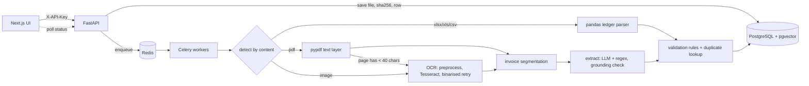

# Invoice desk: AI-powered document intelligence

Ingest PDFs, scans (JPG/PNG/TIFF) and spreadsheets (XLSX/XLS/CSV), extract structured invoice data, validate it, and make it searchable and correctable through a REST API and a Next.js UI.

## Quick start

```bash
cp .env.example .env            # set API_KEY (and optionally ANTHROPIC_API_KEY)
docker compose up --build       # Postgres+pgvector, Redis, API, Celery worker, frontend
# UI: http://localhost:3000   API docs: http://localhost:8000/docs
```

Without Docker (dev mode, SQLite, no Redis; jobs run in-process):

```bash
sudo apt install tesseract-ocr poppler-utils
cd backend && pip install -r requirements-dev.txt
INLINE_JOBS=true API_KEY=dev-key-change-me uvicorn app.main:app --reload
cd ../frontend && cp .env.example .env.local && npm install && npm run dev
```

Tests and evaluation:

```bash
cd backend
pytest -v                                   # unit + API tests
python -m evaluation.evaluate --regen       # regenerates the labelled set, writes evaluation/results/report.md
python -m evaluation.evaluate --llm         # same, with the LLM path (needs ANTHROPIC_API_KEY)
```

## Architecture



| Concern | Decision | Why |
|---|---|---|
| Language | Python end to end (FastAPI) | OCR, pandas and LLM libraries are Python; one runtime, fewer moving parts than NestJS + Python workers |
| Queue | Celery + Redis, `acks_late`, exponential backoff for transient errors only | OCR/LLM are slow; permanent errors (corrupt file) fail immediately instead of retrying |
| DB | PostgreSQL + pgvector | metadata, JSONB, full-text (GIN) and vector search in one store, with transactional corrections |
| 1 document -> N invoices | `invoices` table, page ranges | a 1000-page PDF holds hundreds of invoices |
| OCR | PDF text layer first, OCR only for pages without text | digital PDFs cost milliseconds; OCR pages run in a thread pool |
| Extraction | LLM (optional) merged with deterministic regex; every value must be found in the source text | see "No invented values" |
| Spreadsheets | deterministic header mapping, no LLM | exact, free and instant; unrecognised sheets fall back to the text extractor |

Schema: `docs/schema.sql`. Tables: `documents`, `pages`, `chunks`, `invoices`, `line_items`, `validation_issues`, `processing_events`, `corrections`.

### No invented values
1. The prompt forbids inference and requires `null` for anything not printed (`backend/app/core/prompts.py`).
2. **Grounding check** (`extract.py`): every returned string, amount, date, currency and line item must be traceable to the source text. Otherwise it is discarded and noted. A fabricated line item whose amount coincidentally matches a number in the text is still dropped because its description must appear too.
3. LLM and regex disagreements lower confidence; low OCR confidence scales all field confidences down; anything under 0.6 forces manual review.
4. The document text is treated as untrusted data in the prompt (prompt-injection defence).

### Validation (`core/validation.py`)
Missing required fields; invalid/negative numbers; invalid or future dates; unknown currency; `qty x unit price = amount`; `sum(lines) = subtotal`; `subtotal + tax = total` (tolerance max(0.02, 0.1%)); implied tax; suspicious tax rate; low confidence; duplicates (same supplier + invoice number, or same supplier + date + total; also identical file hash). Any error, or a review-class warning, sets `needs_review`.

### API (all under `/api`, header `X-API-Key`)
| Method | Path | Purpose |
|---|---|---|
| POST | `/documents` | multi-file upload; returns accepted + rejected (type, size, empty) |
| GET | `/documents`, `/documents/{id}` | list with status counts; detail with processing history |
| GET | `/documents/{id}/status` | status, progress %, stage, attempts, error |
| GET | `/documents/{id}/result` | invoices, line items, issues |
| GET | `/documents/{id}/text`, `/file` | extracted text per page; original file |
| PATCH | `/invoices/{id}` | manual correction (re-validates, writes audit trail); `approve=true` accepts as is |
| GET | `/invoices/{id}/corrections` | audit trail |
| POST | `/documents/{id}/reprocess`, `/documents/reprocess-failed` | re-run failed jobs |
| GET | `/search` | `mode=keyword|semantic` plus filters (supplier, customer, number, currency, dates, totals, status, needs_review) |
| GET | `/reconcile?left=&right=` | PDF-vs-PDF or PDF-vs-Excel cross-verification by invoice number |

### Security
API-key auth (constant-time compare); content sniffing instead of trusting extensions; random server-side file names (path-traversal safe); per-file size and per-request count limits; streaming upload; decompression-bomb and page-count limits; OCR timeouts; non-root container; no secrets in the repo; SQL via ORM only. Production TODOs: replace the shared key with real user auth/SSO, put the API behind a gateway/TLS with rate limiting, malware-scan uploads, encrypt storage at rest.

### Scalability
Stateless API; workers scale horizontally (`docker compose up --scale worker=N`); set `OMP_THREAD_LIMIT=1` and run one OCR per core; DB writes throttled; chunked embedding batches; HNSW and GIN indexes; dedupe lookups hit a composite index.

## Measured results

All numbers below were measured in a 1-CPU sandbox with Tesseract, rule-based extraction (no LLM key), on the labelled set in `backend/evaluation/dataset` (31 files, 56 labelled invoices: digital PDFs incl. multi-invoice, scanned PNG/JPG/TIFF/PDF at clean/noisy/poor quality, XLSX/CSV ledgers, a duplicate pair, 4 corrupted files). Full report: `backend/evaluation/results/report.md`.

| Metric | Result |
|---|---|
| Overall field accuracy | **95.3%** (invoices with every field right: 94.6%) |
| Digital PDF / XLSX / CSV accuracy | **100%** |
| Scans | all 7 clean/noisy scans fully correct; all 3 **poor** scans (half resolution, heavy blur+noise) wrong: 2 flagged for review, 1 yielded no invoice |
| Line-item amount F1 | 85.5% |
| Document success / failure rate | 96.3% / 3.7% (the 3.7% is one poor scan with no invoice recovered) |
| Corrupted files rejected cleanly | 100% (4/4) |
| Validation flag recall / precision | **100% / 92.3%** |
| Wrong extractions caught by a review flag | 100% (2 of 2; none silently accepted) |
| Speed | digital PDF ~10 ms; clean scan ~1.5 s; XLSX/CSV ~10-60 ms; **1000-page digital PDF -> 1000 invoices in 1.2 s, all correct, 95 MB peak RAM**; poor scans up to ~25 s (OCR timeout) |

**Read these honestly.** The dataset is synthetic (generated from 3 templates), so accuracy on real, messier invoices will be lower. It is a regression harness plus a lower-bound sanity check, not a production benchmark. Replace or extend `evaluation/dataset` with your real labelled documents (same `ground_truth.json` format) and re-run. The LLM path is implemented and unit-tested with a stub but was **not** measured: no API key or network was available.

## Test status
- Executed here: 44 tests covering helpers, content detection, PDF text/OCR fallback, multi-invoice segmentation, spreadsheets (multi-sheet, encodings, malformed), extraction, hallucination discarding, validation, reconciliation, and corrupted-file failures: **44 passed** (run through a minimal pytest-compatible runner because pytest could not be installed offline; they are standard pytest tests).
- **Written but not executed in my environment:** `tests/test_api.py` (FastAPI/SQLAlchemy were not installable offline), the Celery path, Postgres/pgvector queries, and the Next.js build (`npm install` was unavailable). Run `pytest -v` and `npm run build` first; expect to fix minor issues.

## Known limitations
- Semantic search defaults to a hashed bag-of-words embedder (offline, deterministic, lexical). Set `EMBEDDING_BACKEND=st` for real semantic embeddings.
- Line items from OCR/regex rely on one-row-per-line layouts; complex tables need the LLM.
- Ambiguous `dd/mm` vs `mm/dd` dates default to day-first unless a value exceeds 12.
- Handwriting, rotated-90° pages and non-Latin scripts are not tuned (`OCR_LANG` is configurable).
- A bare `$` is treated as USD by the regex extractor (confidence 0.6, so it is flagged).

## AI disclosure
See `docs/AI_DISCLOSURE.md`; runtime prompts are in `backend/app/core/prompts.py`.
